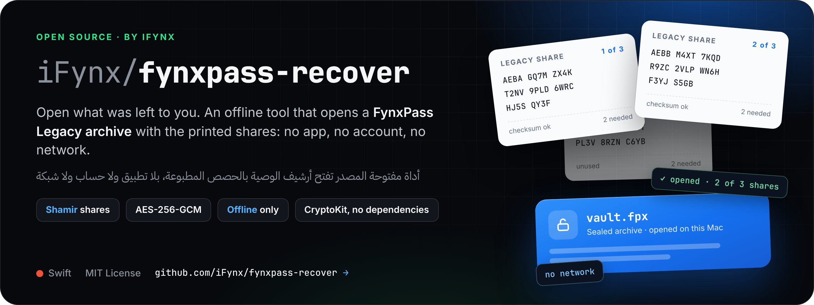
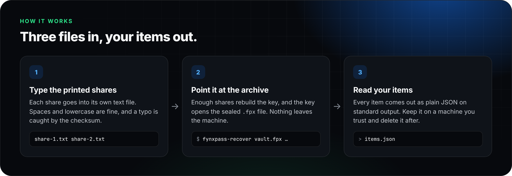
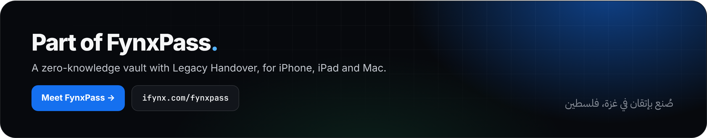

<a href="https://ifynx.com/fynxpass/">
  <picture>
    <source media="(prefers-color-scheme: dark)" srcset=".github/assets/banner-dark.png">
    <source media="(prefers-color-scheme: light)" srcset=".github/assets/banner-light.png">
    
  </picture>
</a>

<div align="center">

[](LICENSE)


[English](#english) · [العربية](#العربية) · [FynxPass](https://ifynx.com/fynxpass/)

</div>

---

<a id="english"></a>

## Why this exists

FynxPass Legacy splits the key of a sealed archive into printed shares, of which a set number together open it. If FynxPass is ever not there for the people you chose, they can still open what you left them with this tool and enough shares.

That promise is only worth something if you can check it. So the tool is small, has no dependencies, never touches the network, and is yours to read, build and keep.

| | |
|---|---|
| **Offline** | The code never opens a socket, a URL or a connection. It reads only the files you name and writes only to standard output. |
| **Small enough to read** | Two source files. The only cryptography library is Apple's CryptoKit. |
| **Tested against the app** | The test vectors were written by the FynxPass app's own code. |
| **Fails closed** | Any failure prints one line, `recovery failed`, and never says which part was wrong. |

<picture>
    <source media="(prefers-color-scheme: dark)" srcset=".github/assets/steps-dark.png">
    <source media="(prefers-color-scheme: light)" srcset=".github/assets/steps-light.png">
    
  </picture>

## What it needs

- A Mac with macOS 13 or later and Swift 6 (Xcode 16 or the Swift toolchain).
- The archive file (`.fpx`).
- At least as many printed shares as were set when the archive was made, each typed or pasted into its own text file. Spaces, line breaks and lowercase letters are fine. A typo is caught by the share's checksum.

## Quick start

```sh
git clone https://github.com/iFynx/fynxpass-recover.git
cd fynxpass-recover
swift build -c release

.build/release/fynxpass-recover vault.fpx share-1.txt share-2.txt > items.json
```

On success it prints the items as JSON:

```json
[{"title":"Example Bank","typeID":"login","values":{"password":{"text":"…"},"username":{"text":"…"}}}]
```

Every value is either `{"text": "…"}` or `{"list": ["…"]}`. Passkey private keys are left out, as in the app's own export.

On any failure it prints one line, `recovery failed`, and exits with a non-zero status. It does not say which part was wrong: a share, the archive, or too few shares.

> [!WARNING]
> `items.json` holds every secret in clear text. Keep it on a machine you trust, and delete it when you are done.

## What it does not do

| | |
|---|---|
| **No network** | The code never opens a socket, a URL or a connection. The only files it reads are the ones you name, and it writes only to standard output. |
| **No password exports** | An `.fpx` that FynxPass exported with a password (Settings → Export) opens in FynxPass itself (Import). This tool refuses it rather than guess. |
| **No Recovery Kit** | The Recovery Kit restores your FynxPass account in the app. It is not a share and does not open a Legacy archive. |

## How it works

<details>
<summary><b>File formats and cryptography</b></summary>

<br>

- Printed share: Base32 (RFC 4648 alphabet) in groups of four, decoding to `version(1) ‖ threshold(1) ‖ index(1) ‖ y(32) ‖ SHA-256(first 35 bytes)[0..4]`.
- The key: Shamir secret sharing over GF(2⁸) (polynomial 0x11B), Lagrange interpolation at 0.
- The archive: `"FPX1" ‖ flag(1) ‖ salt(16) ‖ Argon2 m, t, p (3 × u32 little-endian) ‖ envelope`, flag `2` for a share-sealed archive. The envelope is `version(1) ‖ nonce(12) ‖ AES-256-GCM ciphertext ‖ tag(16)` with associated data `fpcp1.export.fpx`.
- The only cryptography library is Apple's CryptoKit.

</details>

## Tests

```sh
swift test
```

The vectors in `Tests/RecoverKitTests/Vectors` were written by the FynxPass app's own code: an archive, three printed shares (2 of 3), the JSON the app prints for them, and a password export the tool must refuse.

---

<a id="العربية"></a>

<div dir="rtl" align="right">

## العربية

<b>fynxpass-recover</b> أداة مفتوحة المصدر تعمل بلا إنترنت، تفتح أرشيف الوصية من FynxPass (ملف <code>.fpx</code>) بالحصص المطبوعة، من دون تطبيق FynxPass ومن دون حساب أو شبكة.

ميزة «الوصية» في FynxPass تقسّم مفتاح الأرشيف المختوم إلى حصص مطبوعة، ويكفي عدد محدّد منها لفتحه. فإن لم يكن FynxPass متاحاً يوماً لمن اخترتهم، يستطيعون فتح ما تركته لهم بهذه الأداة وبعدد كافٍ من الحصص.

<b>ما تحتاجه</b>

<ul>
<li>جهاز Mac بنظام macOS 13 أو أحدث مع Swift 6.</li>
<li>ملف الأرشيف (<code>.fpx</code>).</li>
<li>العدد المطلوب من الحصص المطبوعة، كل حصة في ملف نصي خاص بها. المسافات والأحرف الصغيرة مقبولة، وأي خطأ في الكتابة يكشفه رمز التحقق.</li>
</ul>

<b>الاستخدام</b>

</div>

```sh
swift build -c release
.build/release/fynxpass-recover vault.fpx share-1.txt share-2.txt > items.json
```

<div dir="rtl" align="right">

<b>ما لا تفعله الأداة</b>

<ul>
<li><b>لا شبكة:</b> لا تفتح أي اتصال، وتقرأ فقط الملفات التي تسمّيها.</li>
<li><b>لا تفتح التصدير المحمي بكلمة سر:</b> هذا يُفتح من FynxPass نفسه (استيراد).</li>
<li><b>لا تستخدم عدّة الاسترجاع:</b> العدّة تستعيد حسابك داخل التطبيق، وليست حصة.</li>
</ul>

ملف <code>items.json</code> يحتوي كل الأسرار بنص واضح: أبقِه على جهاز تثق به واحذفه عند الانتهاء.

</div>

<br>

<a href="https://ifynx.com/fynxpass/">
  <picture>
    <source media="(prefers-color-scheme: dark)" srcset=".github/assets/footer-dark.png">
    <source media="(prefers-color-scheme: light)" srcset=".github/assets/footer-light.png">
    
  </picture>
</a>

<p align="center"><sub>MIT License · iFynx Integrated Solutions P.S.C. · Gaza, Palestine · <a href="https://ifynx.com/">ifynx.com</a> · <a href="https://ifynx.com/ar/">العربية</a></sub></p>
